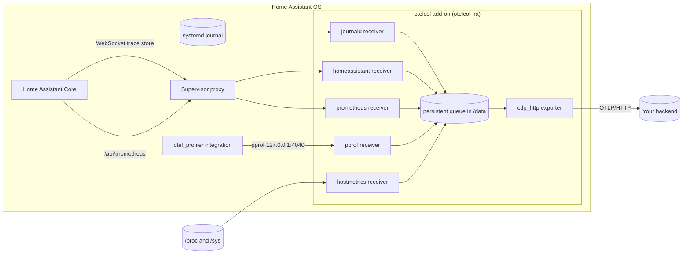

# OTel Collector add-on for Home Assistant


A community Home Assistant add-on that runs a custom build of the OpenTelemetry Collector on
Home Assistant OS and sends logs, traces, metrics and profiles to any [OTLP](https://opentelemetry.io/docs/specs/otlp/)/HTTP backend.

| Signal | Option | Source |
|---|---|---|
| Logs | `logs` | HAOS systemd journal: host services, kernel, Supervisor, Core and every add-on |
| Logs | `core_logs` | Optional: Home Assistant's logs structured (code, exception) and linked to automation traces |
| Logs | `event_logs` | Home Assistant events, linked to the automation trace that caused them |
| Traces | `ha_traces` | Automation and script runs, one trace per run ([Home Assistant receiver](otelcol/collector/receiver/homeassistantreceiver)) |
| Metrics | `entity_metrics` | Every entity state, with device, area and floor |
| Metrics | `container_metrics` | CPU, memory, disk and network of Core, the Supervisor and every add-on |
| Metrics | `host_metrics` | Host CPU, memory, load, paging, network, data disk and uptime (`system.*`) |
| Profiles | `profiles` | Experimental: Home Assistant's Python threads, sampled by a bundled integration |

Runs on `amd64` and `aarch64` (for example a Raspberry Pi running 64-bit Home Assistant OS).

## Install the add-on

[](https://my.home-assistant.io/redirect/supervisor_add_addon_repository/?repository_url=https%3A%2F%2Fgithub.com%2Fnicolastakashi%2Fha-addon-otelcol)

1. Click the badge above to add this repository.
2. Install **OTel Collector (community)**.
3. Set `otlp_endpoint` and `otlp_headers` (see below).
4. Start the add-on.

Without the badge, add the repository URL in **Settings → Add-ons → Add-on store → ⋮ →
Repositories**:

```text
https://github.com/nicolastakashi/ha-addon-otelcol
```

## Configure the minimum

```yaml
otlp_endpoint: https://otlp.example.com
otlp_headers:
  - name: Authorization
    value: Bearer <your-token>
```

Every other option has a default. All signals except `profiles` are on by default.

## Choose a backend

Any OpenTelemetry-compatible backend works: any vendor or self-hosted tool that accepts
OTLP over HTTP (`http/protobuf`). Authentication goes in `otlp_headers`.

OTLP profiles are alpha. Check that your backend accepts them before you enable `profiles`.

## Read the full documentation

- [Docs](otelcol/DOCS.md)
- [CHANGELOG](otelcol/CHANGELOG.md)
- [Home Assistant receiver](otelcol/collector/receiver/homeassistantreceiver/README.md)

## How it works



While the backend is unreachable, data waits in a queue on disk and is sent when it comes
back.

## Semantic conventions and Weaver

The add-on uses [OpenTelemetry semantic conventions](https://opentelemetry.io/docs/specs/semconv/)
wherever they exist (`service.*`, `host.name`, `container.name`, `thread.name`, `user.id`,
`system.*` metrics). Attributes without a convention (`homeassistant.*`, `systemd.unit`,
`syslog.identifier`, `journald.boot_id`, `python.logger.name`) are defined in a
[Weaver](https://github.com/open-telemetry/weaver) registry in [`model/`](model/). The
registry depends on semantic conventions v1.37.0.

## Contributing

Issues and pull requests are welcome. See [CONTRIBUTING.md](CONTRIBUTING.md) to build and test.

## Disclaimer

This is an independent community project. It is not affiliated with, endorsed by or
maintained by the OpenTelemetry project, the CNCF, Home Assistant or the Open Home
Foundation. "OpenTelemetry" and "OTel" are trademarks of The Linux Foundation; they are
used here only to describe what the add-on runs.

## License

[Apache-2.0](LICENSE)
